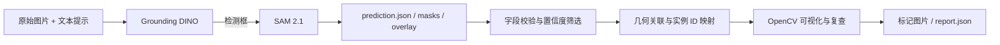
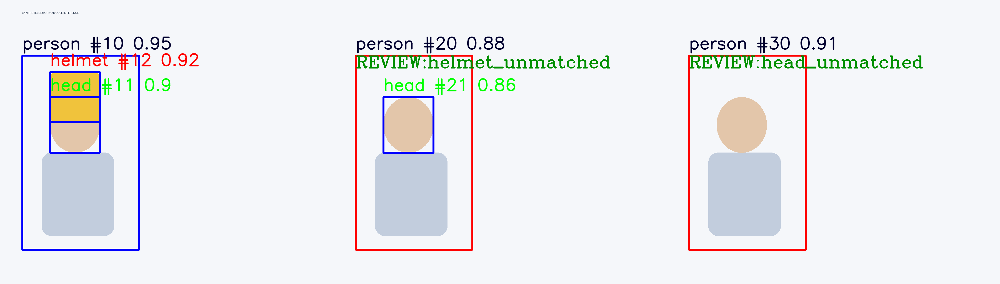

# PPE-Grounded-SAM2

面向安全帽佩戴场景的个人防护装备（Personal Protective Equipment, PPE）视觉分析原型，集成 **Grounding DINO 开放词汇目标检测、SAM 2.1 框提示实例分割、基于几何约束的人员关联，以及检测结果可视化与复查报告生成**。

项目聚焦 `person`、`head`、`helmet` 三类目标，将模型输出转换为可追溯到原始实例 ID 的关联记录，帮助定位需要人工核验的人员。

> 当前已验证数据处理、关联和复查流程。模型接口已实现，真实权重推理与定量精度评估尚待完成；仓库不包含训练代码、预训练权重或第三方数据集。复查标记表示关联信息不足，不等同于已确认未佩戴安全帽。

## 功能

- **COCO 数据检查**：统计类别分布，检查图片缺失、重复 ID、无效标注与越界边界框，导出 JSON 报告。
- **检测与分割接口**：文本提示驱动 Grounding DINO 检测，将像素坐标框传入 SAM 2.1，导出实例掩码、叠加图和结构化预测。
- **人员—头部—安全帽关联**：结合中心点位置、区域覆盖率与一对一贪心匹配建立关联；支持空检测及未匹配目标。
- **结果复查**：过滤低置信度目标，绘制类别、实例 ID 和分数，对关联缺失人员标红并生成复查原因。
- **批量汇总**：输出类别计数、待复查图片、人员复查记录和处理错误；图片处理失败时不合并该图的计数与复查记录。

## 处理流程



`main.py infer` 负责模型推理与预测导出；`scripts/check_prediction_association.py` 负责后续关联、绘图和汇总。关联规则当前仅使用边界框，不使用 SAM 掩码参与匹配。

## 安装

### 基础工具

基础代码使用 Python 3.10+ 语法。进入项目根目录，创建独立环境：

```bash
python -m venv .venv
```

激活环境（选择当前系统对应的命令）：

```powershell
# Windows PowerShell
.\.venv\Scripts\Activate.ps1
```

```bash
# Linux / macOS
source .venv/bin/activate
```

```bash
python -m pip install --upgrade pip
python -m pip install -r requirements.txt
python -m unittest discover -s tests -v
```

基础依赖仅包含 NumPy、Pillow、OpenCV，可在没有 PyTorch、GPU 和模型权重的环境中运行数据工具、关联、复查及测试。标准库模块无需额外安装。

### 模型推理（可选）

模型环境单独配置，参见 [模型推理环境](docs/CLOUD_INFERENCE.md)。先安装与 CUDA 匹配的 PyTorch / TorchVision，再安装官方 Grounding DINO、SAM 2 源码及其依赖。`requirements-models.txt` 不代表已经验证的 GPU 环境锁定文件。

## 快速开始

### 1. 无模型演示

```bash
python examples/run_demo.py
```

脚本生成一张合成示意图及六条预设检测记录，运行实际关联与复查代码，并检查报告是否符合预期。**演示不调用模型，预设分数不是模型预测结果。**

预期得到三个人员关联：一人关联完整，一人缺少安全帽，一人缺少头部；计数为 `person=3, head=2, helmet=1`，复查记录共两条。



```text
outputs/demo/
├── source/
│   ├── demo.png
│   └── prediction.json
└── check/
    ├── input/
    │   ├── images/demo.png
    │   └── predictions/0001_demo.json
    ├── output/
    │   ├── images/demo.png
    │   └── report.json
    └── integration_summary.json
```

脚本要求输出目录不存在或为空，以免覆盖已有结果。再次运行可指定新目录：

```bash
python examples/run_demo.py --output-dir outputs/demo_02
```

### 2. 接入预测 JSON

输入格式见 [数据与关联约定](docs/DATA_FORMAT.md)。若已通过模型导出 `prediction.json`，执行：

```bash
python scripts/check_prediction_association.py --prediction outputs/inference/example/prediction.json --output-dir outputs/review/example
```

如果 JSON 内保存的是云端图片路径，可为单图指定本地原图：

```bash
python scripts/check_prediction_association.py --prediction outputs/inference/example/prediction.json --image data_samples/example.jpg --output-dir outputs/review/local_example
```

批量处理时，向 `--prediction` 传入多个文件路径：

```bash
python scripts/check_prediction_association.py --prediction outputs/inference/a/prediction.json outputs/inference/b/prediction.json --output-dir outputs/review/batch_01
```

输入图片必须可读取，实际尺寸须与 JSON 一致，同一批次不能包含重名图片；输出目录须为空。当前串联入口固定使用 `0.6` 分数阈值。输入校验失败会终止本次运行，具体错误见命令行输出。

### 3. 检查 COCO 数据

将自备数据集放在 `data/` 中，保持以下结构：

```text
data/your_dataset/
├── train/
│   ├── _annotations.coco.json
│   └── *.jpg
└── test/
    ├── _annotations.coco.json
    └── *.jpg
```

```bash
python main.py inspect --dataset-root data/your_dataset --splits train test --report outputs/dataset_report.json
python main.py visualize --dataset-root data/your_dataset --split test --count 8 --seed 42 --output-dir outputs/dataset_preview
```

`visualize` 绘制的是 COCO 标注，不执行模型检测。已有 `valid` 划分时，可在 `--splits` 中补充。

## 关联与复查规则

| 阶段 | 当前规则 |
| --- | --- |
| 置信度筛选 | `detection_score >= 0.6` 的实例参与关联与计数 |
| 人员—头部候选 | 相交面积 / 头框面积 ≥ 0.5，且头框中心位于人框内部及其上半部分 |
| 头部—安全帽候选 | 相交面积 / 安全帽框面积 ≥ 0.5，且安全帽中心不低于头框中心 |
| 候选排序 | 覆盖率降序；并列时按目标索引、来源索引升序，保持结果确定性 |
| 一对一匹配 | 按排序结果贪心选择，两端索引均未使用才保留该配对 |
| ID 映射 | 类别列表中的位置索引映射回输入 `instance_id`，避免将索引误当业务 ID |
| 复查优先级 | 缺头部：`head_unmatched`；有头部但缺安全帽：`helmet_unmatched` |

这里的覆盖率以头框或安全帽框面积为分母，**不是 IoU**。关联按两阶段顺序执行，不是全局最优分配。每个达标人员最多产生一条复查记录；全部复查记录的初始状态为 `pending`。

## 项目结构

```text
PPE-Grounded-SAM2/
├── main.py                          # 数据检查、标注预览、环境检查、模型推理 CLI
├── association_practice.py          # 手写几何计算与一对一关联算法
├── PPE_check_results.py             # 单图校验、绘图与批量复查脚本
├── src/
│   ├── schema.py                    # 边界框、检测、分割结果的数据结构
│   ├── environment.py               # 模型依赖与 CUDA 状态检查
│   ├── datasets/                    # COCO 读取与数据检查
│   ├── detection/                   # Grounding DINO 适配
│   ├── segmentation/                # SAM 2.1 适配
│   ├── pipeline/                    # 检测与分割串联
│   ├── export/                      # 预测 JSON、掩码和叠加图导出
│   ├── association/                 # 预测校验、分数筛选及实例 ID 映射
│   └── visualization/               # COCO 标注预览
├── scripts/check_prediction_association.py
├── examples/                        # 无权重合成演示及预期报告
├── tests/                           # 单元测试与串联测试
├── docs/
│   ├── CLOUD_INFERENCE.md
│   └── DATA_FORMAT.md
├── checkpoints/                     # 本地模型权重（不提交）
├── data_samples/                    # 本地推理图片（不提交）
├── outputs/                         # 本地运行产物（不提交）
├── requirements.txt                 # 基础依赖
├── requirements-models.txt          # 可选模型依赖
└── LICENSE
```

`association_practice.py` 保留算法分步实现；当前仍是运行时依赖。`PPE_check_results.py` 按工作目录读取 `input/`，直接导入会执行批处理，建议通过串联脚本调用。串联脚本会准备独立的输入输出目录，再启动该脚本。

## 验证与限制

```bash
python -m unittest discover -s tests -v
python main.py doctor
```

- 测试覆盖 COCO 解析、模型接口适配、预测导出、原始 ID 映射、边界输入和真实复查脚本串联；模型接口测试使用替身，不加载真实权重。
- 当前本地基础流程已在 Windows / Python 3.14.6 上验证；不代表所有 Python 版本或 GPU 组合均经过验证。`doctor` 检查依赖可见性及 CUDA 状态，不保证权重、CUDA 扩展或模型推理可用。
- 使用真实图片和 COCO 标注转换数据做过离线流程联调。标注框及占位分数不能用于声明模型检测精度或推理性能。
- 依赖每个已佩戴安全帽人员也能得到可匹配的 `head` 检测。若数据集的 `head` 只标注裸露头部，当前关联链可能产生大量复查项，需要调整数据定义或关联策略。
- 尚未实现跨帧跟踪、全局最优匹配、掩码参与关联、交互式复查界面或人工反馈回写。拥挤场景中的跨目标标签遮挡仍需优化。

## 贡献与问题反馈

欢迎通过仓库 Issues 提交问题或通过 Pull Request 改进实现。报告问题时请附 Python / 依赖版本、运行命令、最小可复现输入及错误信息。修改后请运行测试；合入示例请使用合成数据或已获得授权的数据，避免提交本地路径、凭证、模型权重和运行产物。

## 许可与致谢

本项目原创代码采用 [MIT License](LICENSE)。第三方源码、模型权重和数据集分别遵循其上游许可，不因本仓库采用 MIT 而变更。

- [Grounding DINO](https://github.com/IDEA-Research/GroundingDINO)：开放词汇目标检测；使用前查阅其 [LICENSE](https://github.com/IDEA-Research/GroundingDINO/blob/main/LICENSE)。
- [SAM 2](https://github.com/facebookresearch/sam2)：框提示图像分割；模型与源码的许可及第三方组件说明见 [官方许可说明](https://github.com/facebookresearch/sam2#license)。
- [Hard Hat Workers](https://public.roboflow.com/object-detection/hard-hat-workers/)：用于本地数据检查与离线联调，原始数据来源见 [Harvard Dataverse](https://doi.org/10.7910/DVN/7CBGOS)。请按下载版本的说明确认数据许可和标注定义；仓库不分发该数据集。

本仓库是独立应用原型，不是上述模型或数据集的官方实现。
